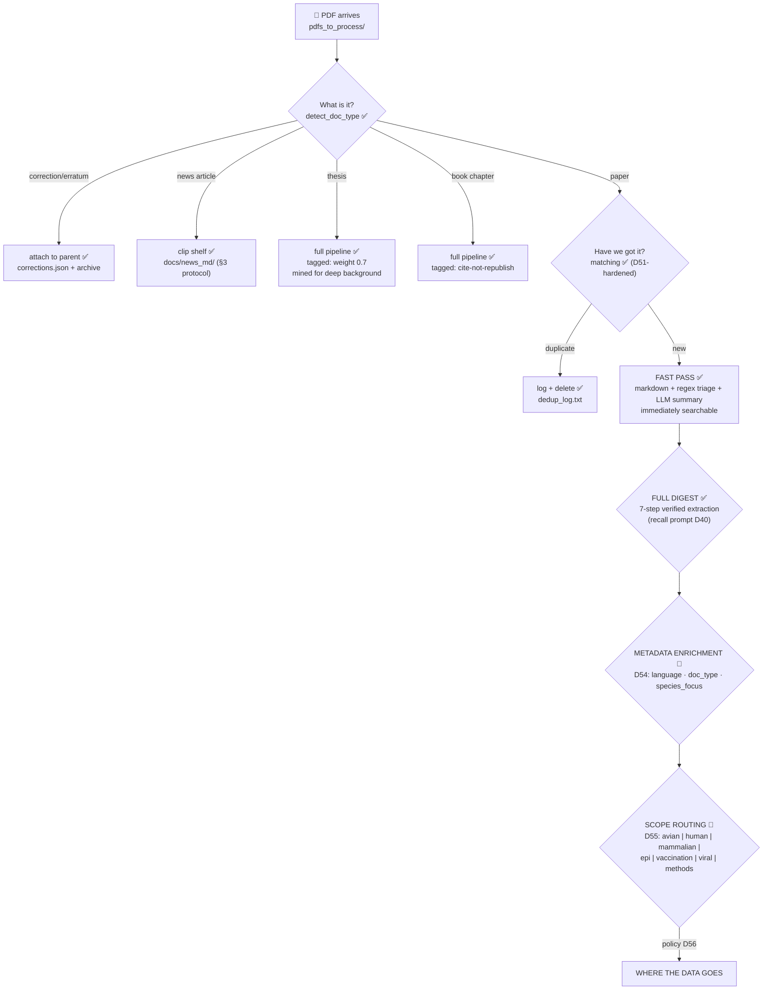

# The Paper Decision Pipeline

How every incoming document is typed, parsed, enriched, scoped, and routed
to its destinations. Status: ✅ built · 🔧 partial · 📋 planned.

## Routing destinations (the D56 policy, in effect)

| Consumer | avian | human/mammal | epi | vaccination |
|----------|-------|--------------|-----|-------------|
| **Gene evidence** (wiki, badges) | full weight ✅ | text-scan credit, via-taxon 🔧 | text-scan only ✅ | full ✅ |
| **Species wiki pages** | yes ✅ | no | outbreak context ✅ | target species ✅ |
| **Model badges** | counts as avian 🔧 | counts as mammalian context 🔧 | no | yes |
| **Synthesis strategies** | all | cross_taxa, contradiction ✅ | cross_taxa | same_gene |
| **Discovery report** | yes | yes — genes lacking avian data ✅ | no | yes |
| **Search/rg corpus** | always — everything, every scope ✅ |||

## Trust weights (doc_type)

peer-reviewed 1.0 · review 1.0 · book-chapter 1.0 · report 0.8 ·
thesis 0.7 · preprint 0.6 · correction attach-only · news clip-only

## What remains to wire 🔧

1. **Model badge split** — `gene_evidence_counts` gains `avian_papers`;
   badges show "N papers (M avian)" when they differ
2. **Evidence rows carry scope** — gene pages can then distinguish
   "avian evidence: N · mammalian context: M"
3. **Consumers read pipeline_policy.json** — currently documentation-grade;
   make build_wiki_pages/synthesize consult it programmatically

## Design rules (invariants)

- **Scope is routing, never exclusion** — everything is searched, mined,
  and summarized; scope decides *weight and destination* only
- **Deterministic before LLM** — venue regex beats model guesses;
  markdown markers beat both; LLM fills the remainder
- **Every deletion is logged** — dedup ledger accounts for every PDF ever
  seen; corrections are archived, never deleted
- **Provenance everywhere** — regex vs verified, via_alias vs direct,
  text_scan vs studied, thesis vs peer-reviewed: always visible downstream
