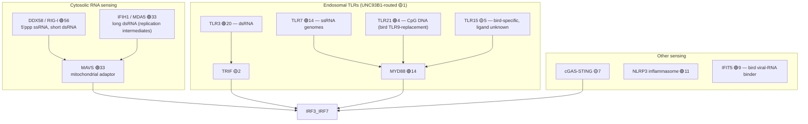
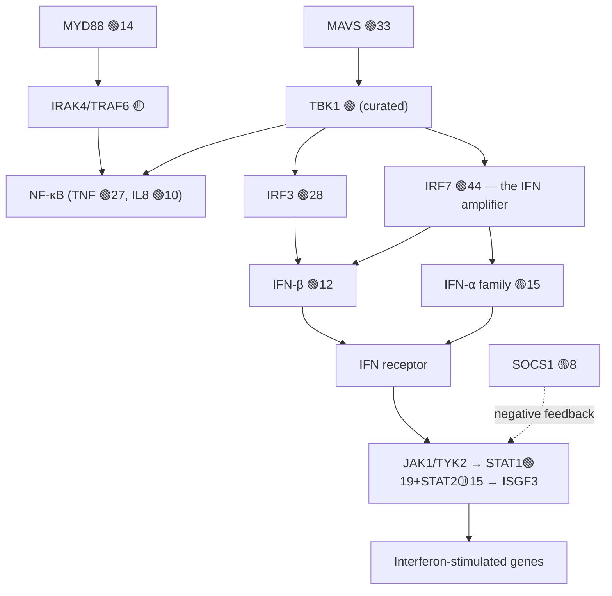
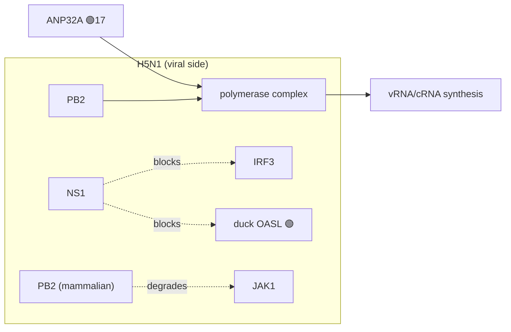
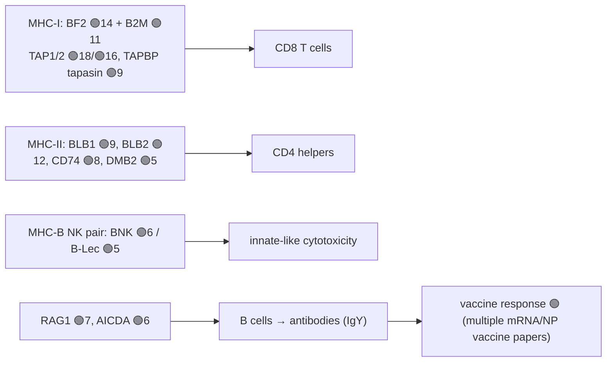

# The Avian Response to H5N1 — A Working Model

**Version 0.1 · 2026-09-01 · built from the Roost corpus (477+ papers, 272 verified analyses)**

A species-agnostic (but avian-specific) model of how birds detect, signal, and
respond to H5N1 — with species differences called out, every node carrying an
evidence badge, and gaps registered explicitly.

**Evidence badges** (regenerable from `data/papers/gene_evidence_counts.json`):
- `🟢 N` — N corpus papers study this node (verified extraction)
- `🟡 N` — N corpus papers mention it (text-scan tier or alias-derived)
- ` curated ` — established biology, no corpus papers yet
- ` GAP ` — no corpus evidence; lit search or documented gap
- Panel presence across 15 genomes: see gene pages (all 587 searched)

---

## Stage 0 — Exposure & Barriers

```
Environment → mucosal/airway epithelium → infection requires:
  α2,3-linked sialic acids (avian receptor) — ubiquitous in birds
  (vs α2,6-dominant human airways — the host-range gate)
```

Not modelled at gene level in our panel (glycosyltransferase genes are a
**registered gap** — ST6GAL1 etc. not searched).

---

## Stage 1 — Recognition (Sensing)

The critical divergence point between bird lineages.



### The species split that defines avian H5N1 biology

| Sensor | Duck | Chicken | Kākāpō | Kiwi (4 spp) | Kea | Takahē | Reference |
|--------|------|---------|--------|--------------|-----|--------|-----------|
| **RIG-I (DDX58)** | ✓ (Z) | ✗ **absent** | ✓ (Z) | fragment | fragment | ✓ | panel presence (E-ladder) |
| **MDA5 (IFIH1)** | ✓ | ✓ (primary) | ✓ | ✓ | ✓ | ✓ | 🟢33 |
| **OASL** | ✓ RIG-I-mimic | ✓ | ✓ | ✓ | ✓ | ✓ | 🟢17 |

**Key claims the corpus supports:**
- Chickens lost RIG-I lineage-wide (galliform; turkey too) and *survive on MDA5 alone* —
  slower IFN response, higher susceptibility 🟢 (multiple papers)
- Ducks have **both** sensors plus OASL acting as a RIG-I mimic (senses dsRNA
  without enzymatic activity) — the tolerance/reservoir phenotype 🟢
- **DDX58 is Z-linked in birds** (our panel data, all chromosome-level assemblies) —
  sex-biased susceptibility prediction, untested *(registered gap)*
- Kiwi/kea/hoiho RIG-I fragments: exon evidence strong (e.g. NI brown kiwi
  8 exons, e=3.9e-111) — likely assembly-quality truncation, not true loss

---

## Stage 2 — Signaling Cascade



**Species/viral notes:**
- **PB2 degrades JAK1** to evade STAT signalling (corpus: input_2024_90) —
 哺乳alian data, avian relevance *(gap: does avian-adapted PB2 do this in birds?)*
- NS1 antagonises IRF3/IRF7 activation upstream (well established 🟢)
- **Duck OASL bypasses NS1 inhibition** by activating RIG-I directly 🟢

---

## Stage 3 — Effector ISGs (the antiviral state)

| Effector | Mechanism | Evidence | Avian specifics |
|----------|-----------|----------|-----------------|
| MX1 🟢46 | blocks viral transcription | strongest-covered gene after DDX58 | kākāpō MX1 absent from panel assembly (assembly artifact?) |
| IFITM3 🟡23 | blocks entry/fusion | chicken IFITM3 restriction paper now in corpus | family expanded in some lineages |
| IFIT5 🟢9 | degrades viral RNA | bird-specific role in chickens | |
| RSAD2/viperin 🟢12 | disrupts budding | | |
| EIF2AK2/PKR 🟢13 | translation shutoff | | |
| OAS/RNaseL | RNA degradation | OAS family 🟡 | |
| ISG15/HERC5 🟢22+6 | protein ISGylation | | |
| BST2/tetherin GAP | traps budding virions | **no corpus papers** | lit search needed |

---

## Stage 4 — Viral Dependency & Antagonism (the other side)



- **ANP32A** is the host dependency: avian ANP32A's 33-aa insertion enables the
  viral polymerase 🟢. Gene-edited chickens (N129I/D130N) resist infection 🟢.
- ANP32B/E as compensatory cofactors 🟢 — whole-family editing proposed.
- **Host-range gate**: mammalian ANP32 lacks the insertion; PB2 adaptations
  (E627K etc.) partially compensate 🟢 — the bridge into mammals.

---

## Stage 5 — Cell-Death & Inflammation Outcomes

| Pathway | Genes | Evidence |
|---------|-------|----------|
| Apoptosis | CASP3 GAP, CASP6 GAP | **no avian corpus papers** |
| Pyroptosis/inflammasome | NLRP3 🟢11, CASP1 *(not in panel)* | mammalian-biased |
| Necroptosis/pan-inflammatory | TNF 🟢27 | |
| Autophagy | ATG5 GAP | |

**Gap: the entire cell-death arm of avian H5N1 pathology is unstudied in our
corpus** — how ducks clear infection non-lytically (cf. input_2024_29) while
chickens die with massive apoptosis is THE tolerance-vs-susceptibility
question.

---

## Stage 6 — Adaptive Immunity (bird-style)



- Chicken **minimal MHC-B** (B locus, chromosome 16): tight gene density, strong
  disease associations (classic Kaufman story). **Naming**: birds use B-locus
  symbols — **BF** = class I (BF2 dominant; BF1 minor), **BLB/DMB** = class II,
  **BG** = class IV, **BNK/B-Lec** = NK receptor–ligand pair; HLA names are the
  human orthologs and never appear in birds. Common aliases are now registered
  in the gene catalogue (searching "MHC", "B-F", "tapasin"… resolves).
- All presentation genes now have corpus backing (TAP1 18pp, TAP2 17pp, BF2 19pp,
  BLB2 13pp, B2M 12pp, BLB1 10pp) — the old "BLB1/TAP2 zero papers" badges were
  stale (D47 re-extraction).
- **BNK/B-Lec** (incl. Blec2): MHC-B-encoded C-type lectin-like NK pair. Corpus
  note (input_2024_158): bioinformatic Blec naming is contradictory — "Blec2" in
  some nomenclature is structurally unlike Blec1/3, and the BNK–Blec pair is
  variously written Blec2/Blec1. BNK from a given haplotype was NOT stimulated by
  Blec/BF1/BF2 — ligand is protease-sensitive. Duck MHC expansion differs —
  *(gap: comparative MHC × H5N1 outcome associations, G3)*.

---

## Gap Registry (v0.1)

### Lit-search targets (evidence likely exists, we haven't ingested it)
| # | Gap | Why it matters | Search terms |
|---|-----|----------------|--------------|
| G1 | BST2/tetherin in birds | budding restriction | tetherin avian influenza |
| G2 | CASP3/6 avian apoptosis | pathology tolerance | chicken apoptosis influenza |
| G3 | MHC-B × H5N1 outcome associations (cross-species) | vaccine design | chicken MHC-B influenza; BLB1/TAP2 corpus-backed since D47 |
| G4 | RAG1/AICDA antibody diversity | vaccine response | chicken antibody diversity AID |
| G5 | Sialic acid genetics (ST6GAL1…) | receptor biology | chicken sialyltransferase H5N1 |
| G6 | DDX58 Z-linkage sex bias | NZ management | sex-biased susceptibility influenza |
| G7 | IFITM family bird expansion | entry restriction | IFITM duck chicken |
| G8 | TLR15 ligand identification | bird-specific sensing | TLR15 ligand |

### Documented true gaps (little/no avian literature likely)
| # | Gap | Status |
|---|-----|--------|
| T1 | Kiwi/kea/hoiho/takahē immune responses to H5N1 | nothing exists — these are *our* genomes to mine |
| T2 | Avian cGAS-STING during influenza | thin in any species |
| T3 | Inflammasome (CASP1) in wild birds | mammalian-biased field |
| T4 | Mucosal IgA in wild birds | hard to sample |
| T5 | Temperature-dependence of avian IFN (41°C body temp!) | biochemically obvious, poorly studied |

---

## Update protocol

1. After any paper batch: re-run `build_wiki_pages.py` (refreshes
   `gene_evidence_counts.json`) → bump badge numbers in this doc
2. New papers matching gap IDs (G1-G8): close the gap, note it here
3. New species genomes: extend the Stage-1 species table
4. Version bumps: minor for badge updates, major for structural changes
5. The synthesis engine's `DIGEST.md` candidates feed speculation here
   only after human triage

*This is a model, not a review — it compresses and speculates deliberately.
Every 🟢 badge is corpus-backed; `curated` claims are established biology
pending corpus confirmation; GAPs are opportunities.*
